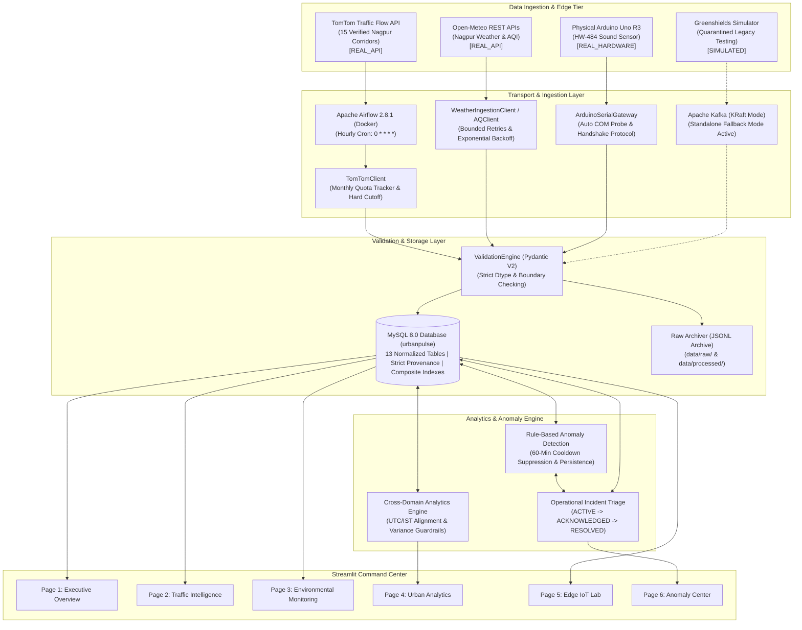

# 🏙️ UrbanPulse NEXUS
### Smart City Data Engineering & Real-Time Urban Intelligence Platform
**Focus Region: Nagpur Municipal Corporation, Maharashtra, India**

[](https://www.python.org/)
[](https://www.mysql.com/)
[-231F20?logo=apachekafka&logoColor=white)](https://kafka.apache.org/)
[](https://airflow.apache.org/)
[](https://streamlit.io/)
[](https://www.arduino.cc/)
[](https://docs.pydantic.dev/)

---

## 📌 Executive Overview

**UrbanPulse NEXUS** is an end-to-end Smart City Data Engineering and urban analytics platform built specifically for **Nagpur, Maharashtra**. The platform integrates real-world telemetry across three essential urban infrastructure domains:

1. **Genuine Corridor Traffic Flow (`REAL_API`):** Real-world vehicular velocity, travel times, and delays collected across 15 geographically verified Nagpur arterial corridors via the TomTom Traffic Flow API, scheduled hourly via Apache Airflow with persistent monthly budget protection.
2. **Live Environmental Observations (`REAL_API`):** Continuous weather and air quality monitoring (temperature, relative humidity, wind speed, precipitation, PM2.5, PM10, NO2, CO, and US-EPA AQI) fetched from Open-Meteo REST APIs.
3. **Physical Microcontroller Telemetry (`REAL_HARDWARE`):** Physical edge environmental sensing via an Arduino Uno R3 with a physical HW-484 sound sensor module over a PySerial gateway, alongside multi-sensor channel discovery and configuration.

The platform processes these streams using dual transport mechanisms (Kafka streaming and scheduled Airflow batch rollups), stores validated observations in a normalized MySQL 8.0 relational schema, enforces strict data provenance to isolate real telemetry from archived test simulations, detects real-time urban anomalies with alert-cooldown suppression, and renders an executive operations command center via Streamlit.

---

## 🎯 Problem Statement & Objectives

### The Engineering Challenge
Municipal administrations frequently struggle with fragmented data silos:
- Atmospheric monitoring networks publish periodic batch observations.
- Road traffic telemetry produces high-velocity continuous events with non-trivial rate limits.
- Edge IoT sensors operate on microcontrollers with serial links and intermittent connectivity.
- Disparate timestamp standards (UTC streaming payloads vs. IST meteorological local readings) cause invalid naive database joins and skewed correlations.
- Prototypes often blend synthetic values with real measurements without clear provenance, undermining data integrity and technical honesty.

### Project Objectives
- **Architect Dual Pipelines:** Combine high-throughput streaming (Kafka) with robust, rate-budgeted batch orchestration (Airflow).
- **Ensure Scientific Provenance:** Explicitly tag, validate, and isolate genuine external API data (`REAL_API`), physical microcontroller data (`REAL_HARDWARE`), and historical test models (`SIMULATED`).
- **Enforce Database Integrity:** Implement strict schema constraints, foreign keys, composite indexes, safe numeric conversions, and idempotent `ON DUPLICATE KEY UPDATE` upserts.
- **Quota & Budget Protection:** Ensure third-party API rate limits (e.g., TomTom 16,000 monthly free tier) are guarded with atomic, persistent state trackers and hard safety cutoffs before making external requests.
- **Temporal Alignment:** Mathematically reconcile UTC streaming payloads with IST API observations using hourly interval aggregation rather than naive `MAX(timestamp)` joins.
- **Intelligent Anomaly Detection:** Implement rule-based incident detection with a 60-minute sliding cooldown window to eliminate duplicate alerting, paired with interactive operational triage.
- **Resource Efficiency:** Enable full local reproducibility on a standard laptop (12 GB RAM) via lightweight standalone batch runners and non-blocking service fallbacks.

---

## 🏗️ System Architecture



---

## 🏷️ Data Provenance & Source Taxonomy

To guarantee strict data integrity, all observations stored in the platform carry an immutable `source_type` provenance tag:

| Provenance Tag | Source Description | Ingestion Method | Refresh Frequency | Storage Table |
| :--- | :--- | :--- | :--- | :--- |
| **`REAL_API`** | TomTom Traffic Flow Segment API across 15 approved Nagpur corridors | Apache Airflow hourly DAG (`urbanpulse_tomtom_traffic_ingestion`) | Hourly (`0 * * * *`) | `traffic_readings`, `road_segments` |
| **`REAL_API`** | Open-Meteo Weather & Air Quality APIs (Nagpur coordinates: 21.1458°N, 79.0882°E) | HTTP REST client with 3 bounded retries | Hourly / Manual on-demand sync | `weather_readings`, `air_quality_readings` |
| **`REAL_HARDWARE`** | Physical Arduino Uno R3 with HW-484 sound sensor via USB PySerial | Custom ASCII serial protocol (10-sample sliding average) | Continuous / Streaming | `iot_sensor_readings`, `iot_devices` |
| **`SIMULATED`** | Greenshields traffic models and test triage workflows | Quarantined legacy generators | Manual test verification only | Quarantined in database |

> **Data Integrity Policy:** Operational views on the dashboard strictly query `source_type='REAL_API'` and `source_type='REAL_HARDWARE'`. Archived simulation records are quarantined and completely excluded from operational analytics.

---

## 🛠️ Technology Stack & Responsibilities

| Layer | Component | Technology | Responsibility |
| :--- | :--- | :--- | :--- |
| **Language** | Core Runtime | Python 3.11 / 3.12 / 3.13 | Primary language for data pipelines, API clients, testing, and UI. |
| **Database** | Relational Store | MySQL 8.0 Community | ACID transactions, composite indexes, foreign keys, and idempotent upserts. |
| **Batch Ingestion** | Orchestration | Apache Airflow 2.8.1 (Docker) | Hourly scheduling of TomTom traffic and Open-Meteo weather batch ingestions. |
| **API Client** | Traffic Telemetry | TomTom Traffic Flow API | Segment-level speeds, travel times, delays, and free-flow velocity baselines. |
| **Environmental API**| Atmospheric Telemetry| Open-Meteo REST APIs | Real-time weather, solar metrics, pollutants (PM2.5, PM10, NO2, CO), and US-EPA AQI. |
| **Edge Hardware** | Physical IoT | Arduino Uno R3 & PySerial | Physical acoustic sensor sampling, USB COM auto-probing, and packet validation. |
| **Event Streaming** | Message Broker | Apache Kafka 3.7 (KRaft) | High-throughput decoupled event log with consumer groups and graceful fallback. |
| **Validation** | Data Governance | Pydantic V2 | Type enforcement, boundary checking, and dead-letter queue classification. |
| **Analytics Engine**| Mathematical Processing| Pandas & NumPy | UTC-to-IST timezone conversions, Decimal/float conversions, and correlation matrices. |
| **Frontend** | Command Center | Streamlit 1.42 & Plotly | Interactive operations UI with responsive glassmorphism theme and SVG sparklines. |

---

## 🖥️ Interactive Dashboard Walkthrough (6 Pages)

The UrbanPulse NEXUS Streamlit command center is divided into six specialized views:

### 1. 🏙️ Executive Overview (`dashboard/views/overview.py`)
- **Nagpur Command Banner:** High-contrast glassmorphism hero banner displaying live operational status and ingestion frequency.
- **Citywide KPI Metrics:** 5 standardized metric cards with glowing decorative sparklines covering Monitored Corridors, Network Average Speed, Ambient Temperature, Air Quality Index (AQI), and Active Municipal Incidents.
- **Zero Mile Pillar Reference:** Geographically anchored to Nagpur's historical Zero Mile Stone (21.1458°N, 79.0882°E).
- **Subsystem Diagnostics:** Live health indicators truthfully reporting database connectivity, Kafka broker availability, and serial hardware status.

### 2. 🚦 Traffic Intelligence (`dashboard/views/traffic.py`)
- **Corridor Mobility Profiles:** Comprehensive telemetry across 15 verified Nagpur arterial corridors (Wardha Road, Sitabuldi, Amravati Road, Hingna Road, Central Avenue, etc.).
- **Corridor Explorer:** Interactive visual panel rendering Level of Service (LOS), observed speeds, free-flow baselines, and TomTom confidence metrics without exposing internal segment IDs.
- **Flow Dynamics & Benchmark:** Horizontal bar chart comparing observed velocities against free-flow baselines.
- **Delay & Velocity Reduction:** Dynamically expanding charts illustrating seconds of delay above free-flow and speed reduction percentages with shared informational status when zero.
- **Historical Speed Trajectory:** Multi-corridor time-series comparison across past ingestion cycles.

### 3. 🌤️ Environmental Monitoring (`dashboard/views/environment.py`)
- **Nagpur Weather Conditions:** Ambient temperature, relative humidity, wind velocity, and precipitation with decorative sparkline KPI cards.
- **Air Quality Gauge:** US-EPA standard radial gauge classifying atmospheric conditions from Good to Hazardous.
- **Pollutant Breakdown:** Comparative analysis of particulate matter (PM2.5, PM10), nitrogen dioxide, carbon monoxide, and ozone.
- **Interactive Manual Sync Button:** One-click on-demand Open-Meteo sync that immediately updates database observations.

### 4. 📈 Urban Analytics (`dashboard/views/urban_analytics.py`)
- **Deep Statistical Correlations:** Cross-domain correlation matrix linking mobility speeds/delays against atmospheric variables (temperature, humidity, precipitation).
- **Timezone Reconciliation:** Reconciles UTC ingestion timestamps with Indian Standard Time (IST) using hourly interval buckets.
- **Robust Numeric Handling:** Safe conversion of MySQL `Decimal` types to native floats, with zero-variance guardrails.

### 5. 🔌 Edge IoT Lab (`dashboard/views/iot_monitoring.py`)
- **Physical Hardware Registration:** Collapsed device setup panel enabling USB COM port auto-discovery, firmware handshake verification with `urbanpulse_firmware.ino`, and channel registration in MySQL.
- **Acoustic Telemetry:** Real-time peak-to-peak ADC amplitude tracking from the physical HW-484 sensor with dynamic threshold alarms.
- **Multi-Sensor Telemetry:** Stream separation splitting ambient measurements (°C / %) from analog sensor channels (0–1023 ADC).

### 6. 🚨 Anomaly Center (`dashboard/views/anomaly_center.py`)
- **Operational Incident Triage:** Centralized incident management console tracking urban alerts detected across traffic, weather, and edge sensors.
- **Incident Lifecycle Management:** Stateful operator workflows allowing alerts to transition from **`ACTIVE`** $\to$ **`ACKNOWLEDGED`** $\to$ **`RESOLVED`** with operator notes and timestamps persisted in MySQL.
- **Alert Cooldown:** 60-minute sliding window suppression preventing notification spam.

---

## 🚦 Verified Nagpur Traffic Corridors

All 15 monitored road corridors in Nagpur have been geographically mapped, validated, and verified against genuine TomTom Traffic Flow API segments:

| Corridor ID | Corridor Name | Segment Type | Monitored Coordinates |
| :--- | :--- | :--- | :--- |
| `SEG_NAG_01` | Wardha Road - Airport Corridor | ARTERIAL | `21.0922°N, 79.0625°E` |
| `SEG_NAG_02` | Sitabuldi Main Road | COMMERCIAL | `21.1466°N, 79.0833°E` |
| `SEG_NAG_03` | Dharampeth - Shankar Nagar Road | ARTERIAL | `21.1411°N, 79.0620°E` |
| `SEG_NAG_04` | Sadar Main Road | COMMERCIAL | `21.1610°N, 79.0815°E` |
| `SEG_NAG_05` | Manish Nagar Main Road | SUBURBAN | `21.0910°N, 79.0820°E` |
| `SEG_NAG_06` | Hingna Road | INDUSTRIAL | `21.1150°N, 79.0180°E` |
| `SEG_NAG_07` | Amravati Road | HIGHWAY_LINK | `21.1480°N, 79.0410°E` |
| `SEG_NAG_08` | Kamptee Road | ARTERIAL | `21.1780°N, 79.1120°E` |
| `SEG_NAG_09` | Central Avenue Road | COMMERCIAL | `21.1490°N, 79.1080°E` |
| `SEG_NAG_10` | Medical Square - Ajni Road | ARTERIAL | `21.1270°N, 79.0980°E` |
| `SEG_NAG_11` | Trimurti Nagar Main Road | SUBURBAN | `21.1180°N, 79.0480°E` |
| `SEG_NAG_12` | Nandanvan Main Road | RESIDENTIAL | `21.1350°N, 79.1280°E` |
| `SEG_NAG_13` | MIHAN Access Road | INDUSTRIAL | `21.0580°N, 79.0450°E` |
| `SEG_NAG_14` | Civil Lines Road | ARTERIAL | `21.1550°N, 79.0710°E` |
| `SEG_NAG_15` | Ring Road - Narendra Nagar Corridor | ARTERIAL | `21.1080°N, 79.0880°E` |

---

## ⚡ Local Setup & Execution Guide

### 1. Prerequisites
- **Operating System:** Windows 10/11, macOS, or Linux
- **Python:** 3.11, 3.12, or 3.13
- **Database:** MySQL 8.0 Server (running locally on port 3306)
- **Optional Tools:** Docker Desktop (for Airflow / Kafka) and Arduino IDE (for physical hardware)

### 2. Environment Setup
```powershell
# Clone the repository and navigate into the workspace
git clone https://github.com/your-username/urbanpulse-nexus.git
cd urbanpulse-nexus

# Create and activate virtual environment
python -m venv .venv
.venv\Scripts\Activate.ps1    # On Linux/macOS: source .venv/bin/activate

# Install dependencies
pip install -r requirements.txt

# Configure environment variables from template
cp .env.example .env
```

Edit `.env` with your local database credentials and TomTom API key:
```ini
MYSQL_HOST=localhost
MYSQL_PORT=3306
MYSQL_USER=your_username
MYSQL_PASSWORD=your_password
MYSQL_DATABASE=urbanpulse

TOMTOM_API_KEY=your_tomtom_api_key_here
```

### 3. Database Initialization
```powershell
# Initialize schema, tables, foreign keys, and seed corridor metadata
python database/init_db.py
```

### 4. Running the Dashboard
```powershell
# Launch the Streamlit command center
streamlit run dashboard/app.py
```
Open your browser to: **`http://localhost:8501`**

### 5. Running the Test Suite
```powershell
# Run the complete test suite (95 tests)
python -m unittest discover -s tests -p "test_*.py"
```

---

## 🔌 Edge Hardware Setup (Arduino Uno R3)

1. Open `iot/arduino/urbanpulse_firmware/urbanpulse_firmware.ino` in the Arduino IDE.
2. Connect your Arduino Uno R3 via USB.
3. Attach the HW-484 sound sensor module:
   - **VCC** $\to$ 5V
   - **GND** $\to$ GND
   - **Analog OUT** $\to$ Analog Pin A0
4. Upload the firmware.
5. Launch the serial gateway:
   ```powershell
   python -m iot.serial_gateway.gateway
   ```
6. The gateway automatically detects the USB COM port, verifies the handshake, and ingests telemetry directly into MySQL.

---

## ⚖️ Implementation Status & Technical Honesty

To maintain technical honesty during portfolio reviews and evaluation audits, the boundaries between verified operational systems and simulated fallbacks are documented:

| Feature / Subsystem | Operational Reality & Status | Scope Details |
| :--- | :---: | :--- |
| **TomTom Traffic Flow API** | **VERIFIED OPERATIONAL** | 15 corridors return genuine observations; hourly Airflow pipeline with budget cutoff. |
| **Open-Meteo Weather & AQI** | **VERIFIED OPERATIONAL** | Automated batch ingestion and manual sync button successfully store real Nagpur data. |
| **Physical Arduino PySerial Gateway** | **VERIFIED OPERATIONAL** | Tested with physical HW-484 hardware; handshake discovery and channel configuration active. |
| **MySQL Relational Schema** | **VERIFIED OPERATIONAL** | 13 normalized tables, composite indexes, foreign keys, and idempotent repository methods. |
| **Rule-Based Anomaly Engine** | **VERIFIED OPERATIONAL** | 60-minute sliding cooldown window, threshold evaluations, and full triage state machine. |
| **Apache Kafka Broker** | **STANDALONE FALLBACK** | Standalone fallback handles event persistence directly if local Docker broker is offline. |

---

## 🔮 Future Scalability Roadmap

1. **Distributed Cloud Storage:** Partition raw JSONL files into AWS S3 or MinIO object storage buckets partitioned by year, month, and day (`s3://urbanpulse/raw/year=2026/month=10/`).
2. **Columnar OLAP Engine:** Integrate ClickHouse or Apache DuckDB for sub-second analytical queries across millions of multi-year urban records.
3. **Stream Processing Mesh:** Upgrade single-node consumers to Apache Flink for real-time sliding window map matching.
4. **LoRaWAN / Cellular IoT:** Transition edge microcontrollers from USB PySerial to low-power ESP32 nodes transmitting over MQTT/LoRaWAN for citywide municipal sensor mesh deployment.

---

## 📄 License & Attribution

- **Meteorological Data:** Courtesy of [Open-Meteo.com](https://open-meteo.com/) under CC BY 4.0.
- **Traffic Telemetry:** Powered by the [TomTom Traffic Flow API](https://developer.tomtom.com/).
- **Project License:** MIT License — Developed as a Data Engineering platform for Smart Cities.
