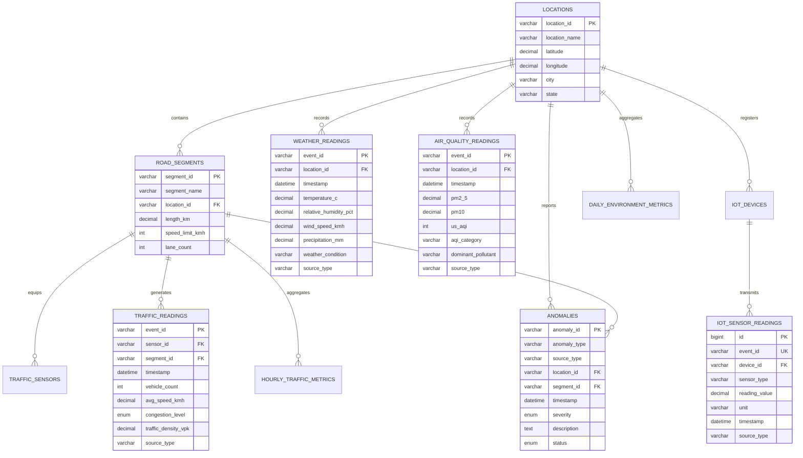

# UrbanPulse NEXUS — Deep-Dive System Architecture

This document provides a technical breakdown of the **UrbanPulse NEXUS** data engineering architecture. Every subsystem, interface, data pipeline, and database relationship documented here corresponds directly to implemented code in this repository.

---

## 1. High-Level Architectural Blueprint

```mermaid
flowchart TD
    subgraph INGESTION["1. Ingestion Layer"]
        subgraph REST_SRC["REST Batch Ingestion"]
            OM_W["Open-Meteo Weather API<br/>(Nagpur: 21.1458°N, 79.0882°E)"]
            OM_AQ["Open-Meteo Air Quality API<br/>(Nagpur: 21.1458°N, 79.0882°E)"]
            W_CLIENT["WeatherIngestionClient<br/>(Bounded Retries & Backoff)"]
            AQ_CLIENT["AirQualityIngestionClient<br/>(Bounded Retries & Backoff)"]
            OM_W --> W_CLIENT
            OM_AQ --> AQ_CLIENT
        end

        subgraph STREAM_SRC["Streaming Ingestion"]
            TRF_SIM["TrafficSimulator<br/>(15 Nagpur Arterials)"]
            K_PROD["TrafficKafkaProducer<br/>(Topic: urbanpulse.traffic.raw)"]
            K_BROKER["Apache Kafka Broker<br/>(KRaft Mode / Fallback Disk Archival)"]
            K_CONS["TrafficKafkaConsumer<br/>(Manual Commit / At-Least-Once)"]
            TRF_SIM --> K_PROD --> K_BROKER --> K_CONS
        end

        subgraph IOT_SRC["Edge IoT Ingestion"]
            ARDUINO["Arduino Uno R3 Firmware<br/>(DHT11, MQ-135, LDR / 9600 bps)"]
            SERIAL_GW["ArduinoSerialGateway (PySerial)<br/>(Auto-Reconnect & Port Probe)"]
            VIRT_GW["Mode A: Virtual Telemetry Gateway<br/>(Synthetic Packet Generator)"]
            ARDUINO -.->|USB Serial| SERIAL_GW
        end
    end

    subgraph VALIDATION["2. Data Validation & Raw Archival"]
        VAL_ENG["ValidationEngine (Pydantic V2)<br/>(Range, Enum & Type Constraints)"]
        RAW_ARCH["Append-Only Raw Archiver<br/>(data/raw/*.jsonl)"]
        REJ_ARCH["Rejected Dead-Letter Store<br/>(data/rejected/*.jsonl)"]
        W_CLIENT --> VAL_ENG
        AQ_CLIENT --> VAL_ENG
        K_CONS --> VAL_ENG
        SERIAL_GW --> VAL_ENG
        VIRT_GW --> VAL_ENG
        VAL_ENG --> RAW_ARCH
        VAL_ENG -.->|Validation Error| REJ_ARCH
    end

    subgraph STORAGE["3. Relational Storage Layer (MySQL 8.0)"]
        DB[("MySQL Database: urbanpulse<br/>13 Normalized Tables")]
        TBL_W["weather_readings"]
        TBL_AQ["air_quality_readings"]
        TBL_TRF["traffic_readings"]
        TBL_IOT["iot_sensor_readings"]
        TBL_ANOM["anomalies"]
        TBL_HTM["hourly_traffic_metrics"]
        TBL_DEM["daily_environment_metrics"]
        TBL_REJ["rejected_records"]
        TBL_RUN["pipeline_runs"]
        TBL_REF["locations, road_segments, traffic_sensors, iot_devices"]

        VAL_ENG -- "Valid (Upsert)" --> DB
        VAL_ENG -- "Invalid (Dead-Letter)" --> TBL_REJ
    end

    subgraph ORCHESTRATION["4. Analytics & Batch Orchestration"]
        AF_RUNNER["Standalone Batch Runner / Airflow DAGs<br/>(airflow/run_pipeline.py)"]
        ANALYTICS["CrossDomainAnalytics & TrafficAnalytics<br/>(UTC-to-IST Hourly Join | Non-Zero Variance Guard)"]
        ANOM_ENG["Anomaly Rule Engine<br/>(60-Minute Cooldown Alert Suppression)"]

        DB <--> AF_RUNNER
        DB <--> ANALYTICS
        DB <--> ANOM_ENG
        AF_RUNNER --> TBL_HTM
        AF_RUNNER --> TBL_DEM
        ANOM_ENG --> TBL_ANOM
    end

    subgraph PRESENTATION["5. Command Center Frontend (Streamlit)"]
        ST_APP["Streamlit Application (dashboard/app.py)<br/>(@st.cache_data / Plotly Dark Navy)"]
        V_OVER["Overview View<br/>(Hero, KPIs & Live Diagnostics)"]
        V_TRF["Traffic View<br/>(Corridor Dynamics & Heatmaps)"]
        V_ENV["Environment View<br/>(AQI Gauge & Manual Sync)"]
        V_ANL["Urban Analytics View<br/>(Correlation Matrix & Bivariate)"]
        V_IOT["Edge IoT Lab View<br/>(Mode A / Mode B & Dynamic Heartbeat)"]
        V_ANOM["Anomaly Center View<br/>(Triage: Acknowledge / Resolve)"]

        DB --> ST_APP
        ANALYTICS --> ST_APP
        ST_APP --> V_OVER
        ST_APP --> V_TRF
        ST_APP --> V_ENV
        ST_APP --> V_ANL
        ST_APP --> V_IOT
        ST_APP --> V_ANOM
    end
```



---

## 2. Ingestion Subsystems

### 2.1 Real API Ingestion Pipeline (`REAL_API`)
- **Components:** [`ingestion/weather/weather_client.py`](file:///C:/Users/Dell/.gemini/antigravity/scratch/urbanpulse/ingestion/weather/weather_client.py), [`ingestion/air_quality/air_quality_client.py`](file:///C:/Users/Dell/.gemini/antigravity/scratch/urbanpulse/ingestion/air_quality/air_quality_client.py).
- **Protocol:** HTTP GET over TLS targeting Open-Meteo Forecast and Air Quality endpoints.
- **Resilience:**
  - Configurable timeout (`settings.API_TIMEOUT_SECONDS = 10`).
  - Bounded exponential retries (`settings.API_MAX_RETRIES = 3` with `1.5 * attempt` sleep backoff).
  - Fallback: Returns `None` on network failure, preventing upstream thread crashes.
- **Data Flow:**
  1. REST response received and JSON decoded.
  2. Deterministic `event_id` computed via SHA-256 hash: `EVT_WTH_{SHA256(location_id + timestamp)[:16]}`.
  3. Raw payload written to disk via `archiver.archive_raw()`.
  4. Record validated via `ValidationEngine.validate_weather()` / `validate_air_quality()`.
  5. Idempotent insertion into MySQL via `repository.insert_weather_reading()` (`ON DUPLICATE KEY UPDATE`).
  6. Processed payload saved to `data/processed/`.
  7. Non-blocking anomaly evaluation executed via `anomaly_engine.check_weather_reading()`.

### 2.2 Simulated Traffic Kafka Pipeline (`SIMULATED`)
- **Components:** [`simulator/traffic_simulator.py`](file:///C:/Users/Dell/.gemini/antigravity/scratch/urbanpulse/simulator/traffic_simulator.py), [`streaming/producers/traffic_producer.py`](file:///C:/Users/Dell/.gemini/antigravity/scratch/urbanpulse/streaming/producers/traffic_producer.py), [`streaming/consumers/traffic_consumer.py`](file:///C:/Users/Dell/.gemini/antigravity/scratch/urbanpulse/streaming/consumers/traffic_consumer.py).
- **Physical Model:**
  - Greenshields speed-density equation: $v = v_f \cdot (1 - \frac{k}{k_j})$, where $v_f$ is free-flow speed ($60\text{ km/h}$) and $k_j$ is jam density ($120\text{ veh/km}$).
  - Time-of-day rush hour modulation (morning peak: 08:30–10:30, evening peak: 17:30–20:00).
  - 15 arterial road segments mapped across Nagpur (Wardha Rd, Amravati Rd, Central Ave, Hingna Rd, Koradi Rd, etc.).
- **Transport & Delivery Semantics:**
  - Kafka Topic: `urbanpulse.traffic.raw` partitioned by `segment_id`.
  - Producer: Resilient initialization; if Kafka broker is unavailable, automatically executes in fallback mode (logs event and preserves local JSONL disk archive).
  - Consumer: Manual commit semantics (`enable_auto_commit=False`, `consumer.commit()` invoked strictly after successful database write) to provide **at-least-once delivery guarantees**.
  - Idempotency: Deduplicated via MySQL unique constraint `UNIQUE KEY uq_traffic_event (event_id)`.

### 2.3 Edge IoT Telemetry Pipeline (`PROTOTYPE / LAB`)
- **Components:** [`iot/arduino/urbanpulse_firmware.ino`](file:///C:/Users/Dell/.gemini/antigravity/scratch/urbanpulse/iot/arduino/urbanpulse_firmware.ino), [`iot/serial_gateway/gateway.py`](file:///C:/Users/Dell/.gemini/antigravity/scratch/urbanpulse/iot/serial_gateway/gateway.py).
- **Hardware Profile:** Arduino Uno R3 (ATmega328P) over USB UART at 9600 bps.
  - Sensor Suite: DHT11 (temperature 0–50°C, humidity 20–90%), MQ-135 (reducing gas resistance ADC 0–1023), LDR (ambient lux voltage divider ADC 0–1023).
  - Frame Specification: `UP_IOT,<DEVICE_ID>,<SENSOR_TYPE>,<VALUE>,<UNIT>,<STATUS>\n`.
- **Dual Telemetry Modes:**
  - **Mode A (Virtual Telemetry Gateway):** Enables developers to generate synthetic sensor readings directly from the Streamlit UI without hardware attached, exercising the entire validation, archival, MySQL loading, and anomaly evaluation workflow.
  - **Mode B (Physical PySerial Gateway):** Dynamically scans available system COM ports using `serial.tools.list_ports.comports()`. If hardware is absent, truthfully reports `⚪ DISCONNECTED` and maintains virtual fallback with zero data loss.
- **Dynamic Heartbeat Lifecycle:**
  $$\text{Status} = \begin{cases} \text{CONNECTED} & \text{if } (t_{\text{now}} - t_{\text{heartbeat}}) \le 300\text{s} \\ \text{STANDBY} & \text{if } 300\text{s} < (t_{\text{now}} - t_{\text{heartbeat}}) \le 3600\text{s} \\ \text{OFFLINE} & \text{if } (t_{\text{now}} - t_{\text{heartbeat}}) > 3600\text{s} \text{ or } t_{\text{heartbeat}} \text{ is NULL} \end{cases}$$

---

## 3. Storage Layer: Normalized Relational Model

The MySQL 8.0 schema comprises 13 normalized tables:



### Key Performance Indexes
- `idx_traffic_segment_time (segment_id, timestamp)`: Composite index enabling sub-millisecond historical corridor range queries.
- `idx_weather_timestamp (timestamp)` & `idx_aq_timestamp (timestamp)`: Accelerated temporal filtering for multi-day observations.
- `idx_anomaly_status (status)`: Fast retrieval for the Anomaly Center triage console.

---

## 4. Analytics, Alignment & Anomaly Engine

### 4.1 Temporal Reconciliation (UTC vs. IST)
A major architectural feature in UrbanPulse NEXUS is the resolution of timezone disparity:
- Traffic streaming payloads and IoT packets carry **UTC timestamps** (`datetime.utcnow()`).
- Open-Meteo API meteorological readings are recorded in **Indian Standard Time (IST, UTC+05:30)**.

To join these datasets accurately without creating artificial cartesian products or single-row `MAX(timestamp)` joins, [`analytics/cross_domain_analytics.py`](file:///C:/Users/Dell/.gemini/antigravity/scratch/urbanpulse/analytics/cross_domain_analytics.py) applies an hourly SQL bucketing strategy:
```sql
DATE_FORMAT(TIMESTAMPADD(MINUTE, 330, t.timestamp), '%Y-%m-%d %H:00:00') = w.hour_bucket
```
This shifts the UTC traffic timestamps by $+330$ minutes (5 hours 30 minutes) into IST and groups observations into matching 1-hour windows.

### 4.2 Correlation Matrix Guardrails
- Naive correlations on joined tables often yield `NaN` values due to zero variance in static columns (e.g. constant temperature or single observation points).
- UrbanPulse dynamically checks column variance before computing Pearson coefficients:
  - Validates that $N \ge 5$ observations exist.
  - Requires non-zero variance ($\sigma^2 > 0$ and $\text{nunique} > 1$) in both mobility and environmental dimensions.
  - **Graceful Fallback:** If environmental variance is zero, the engine computes a 3×3 mobility matrix (`avg_speed_kmh`, `vehicle_count`, `traffic_density_vpk`) and attaches an explicit methodological note:
    > *"METHODOLOGICAL NOTE: Traffic-only correlation matrix shown. Cross-domain environmental observations have zero variance or insufficient temporal overlap for the selected filter."*

### 4.3 Anomaly Engine with 60-Minute Cooldown
[`anomaly_detection/rule_engine.py`](file:///C:/Users/Dell/.gemini/antigravity/scratch/urbanpulse/anomaly_detection/rule_engine.py) implements rule-based event monitoring:
- **Rules Evaluated:**
  - Severe traffic congestion (`avg_speed_kmh < 10` on highways or `congestion_level == 'SEVERE'`).
  - Extreme thermal thresholds (`temperature_c > 45.0` or `< 5.0`).
  - Hazardous air pollution (`pm2_5 > 250.0` or `us_aqi > 300`).
  - IoT hardware threshold violations (`DHT11_TEMP > 48.0` or `MQ135_RAW > 800`).
- **Cooldown Suppression:**
  - When an anomaly fires, the engine queries the `anomalies` table for existing `ACTIVE` incidents of the same type on the same location/segment within the last 60 minutes (`timestamp >= NOW() - INTERVAL 60 MINUTE`).
  - If an active alert exists, new alerts are suppressed, preventing alert flooding.
- **Exact-Event Reprocessing Idempotency:**
  - If an identical observation timestamp is reprocessed, the engine returns the existing `anomaly_id` rather than inserting a duplicate record.

---

## 5. Security & Operational Boundaries

1. **Least-Privilege Database Access:** The repository layer uses parameter bindings (`%(param)s`) across all queries, preventing SQL injection vulnerabilities.
2. **Safe Credential Management:** `.env` files are excluded via `.gitignore`. The application provides `.env.example` as a template.
3. **RAM Optimization:** The standalone runner (`airflow/run_pipeline.py`) executes Airflow DAG tasks sequentially inside Python without launching the memory-heavy Celery worker or Airflow Webserver containers, ensuring smooth operation on 12 GB RAM machines.
